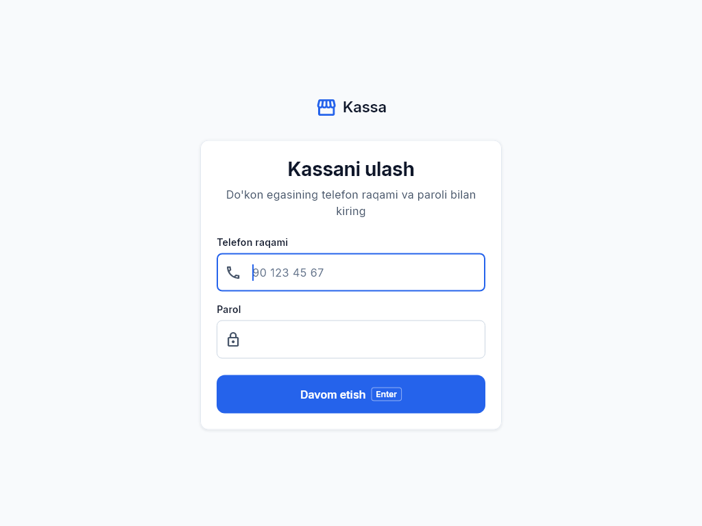
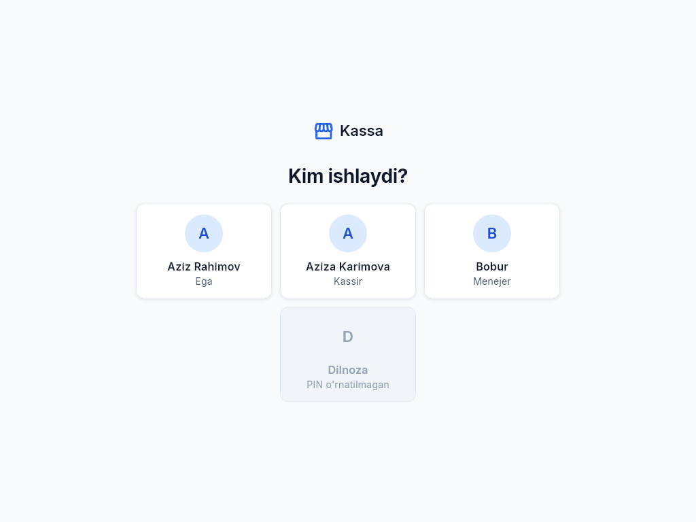
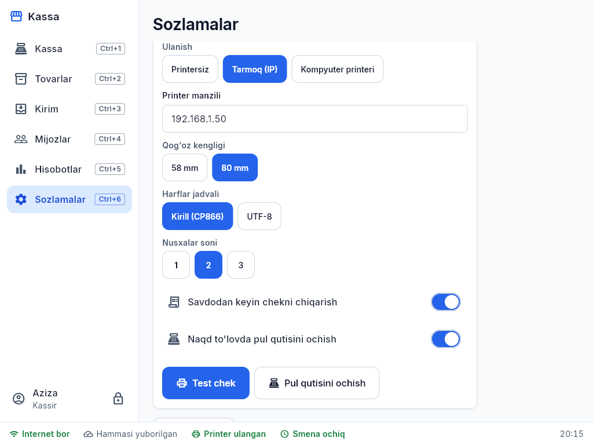

# 1. Boshlash: o'rnatish va ulash

## Dasturni o'rnatish
- **Windows kompyuter:** administrator bergan havoladan `kassa-setup-….exe` ni yuklab oling va ishga tushiring. "Windows kompyuteringizni himoya qildi" chiqsa — **Batafsil → Baribir ishga tushirish**. Ish stolida **Kassa** yorlig'i paydo bo'ladi.
- **Android planshet:** `kassa-….apk` faylini planshetga ko'chiring, oching va "Noma'lum manbalardan o'rnatish"ga ruxsat bering.

Bir do'konda bir nechta kassa bo'lishi mumkin — har birida dastur alohida o'rnatiladi va ulanadi (tarifingizdagi kassalar soni doirasida).

## Kassani do'koningizga ulash (bir marta)
1. Dasturni oching — **ulash** oynasi chiqadi.
2. **Ega telefoni va parolini** kiriting (administrator bergan vaqtinchalik parol).
3. Kassaga nom bering (masalan, "Kassa 1").
4. Birinchi sinxron: tovarlar, xodimlar, mijozlar yuklanadi — internet kerak (bir necha soniya).

Shundan keyin dastur har safar **xodim tanlash va PIN** bilan ochiladi — internet shart emas.

## Xodimlar va huquqlar
| Rol | Nima qila oladi |
|---|---|
| **Ega** | Hammasi: tovar, narx, kirim, hisobotlar, qarz tuzatish |
| **Menejer** | Savdo, kirim, inventarizatsiya, tovarlar, qaytarishni tasdiqlash, hisobotlar |
| **Kassir** | Savdo, nasiyaga sotish (limit ichida), qarz to'lovini qabul qilish, o'z smenasi |

Katta chegirma, qaytarish, qarz limitidan oshish kabi amallarda dastur **menejer yoki ega PIN**ini so'raydi — kim tasdiqlagani yozib qo'yiladi.
Yangi xodim qo'shish yoki PIN o'zgartirish uchun hozircha administrator bilan bog'laning: **+998 91 498 01 68**.

## Sozlamalar (Ctrl+6)
- **Til:** O'zbekcha (lotin), Ўзбекча (кирилл), Русский.
- **Avtomatik qulflash:** kassa tegilmasa necha daqiqada qulflansin (standart 5).
- **Shtrix-kod skaneri:** ovoz va tezlik (skaner sekin bo'lsa "sekin").
- **Chek printeri:** printer turi, qog'oz kengligi (58/80 mm), sinov cheki. Printer bo'lmasa ham savdo ishlaydi.
  - Kompyuterda — "Kompyuter printeri" (Windows'ga o'rnatilgan) yoki "Tarmoq (IP)".
  - Android planshet/telefonda — **Bluetooth** (avval printerni telefonning Bluetooth sozlamalarida juftlang, PIN odatda 0000 yoki 1234), **USB** (OTG kabel orqali; birinchi chekda ruxsat so'raladi — "OK" bosing) yoki "Tarmoq (IP)".
    Ro'yxatdan printerni tanlang va "Test chek" bosing.

