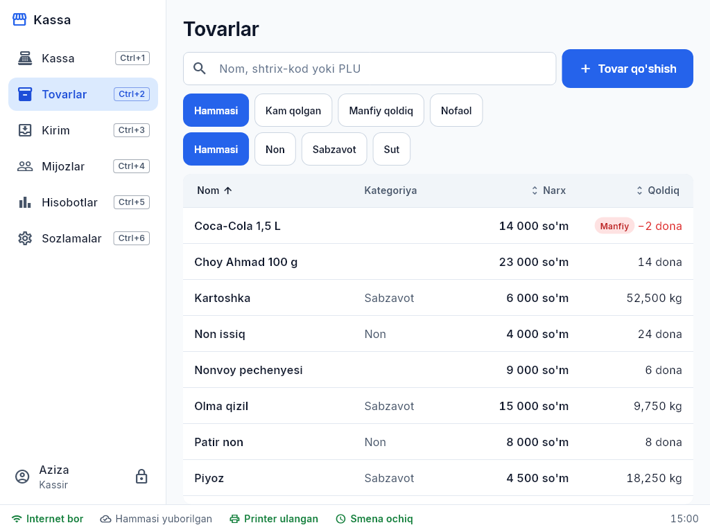
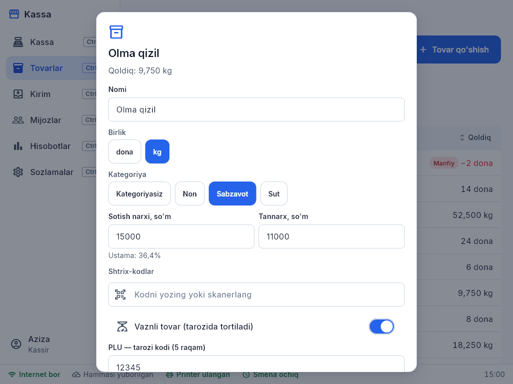
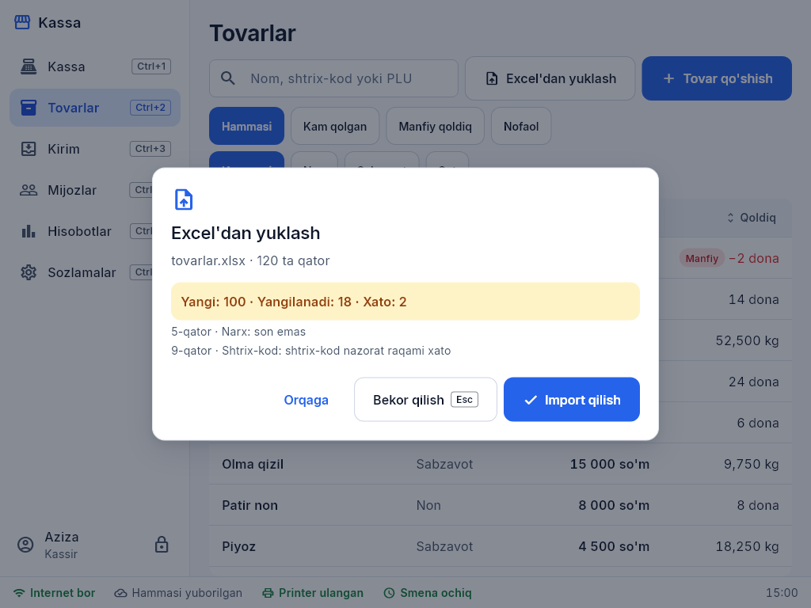
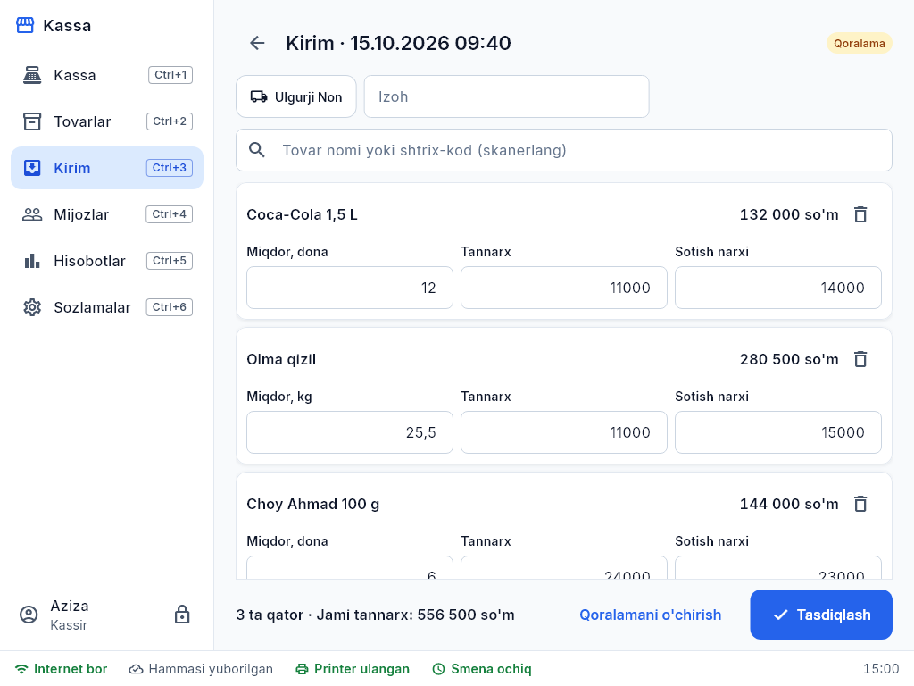
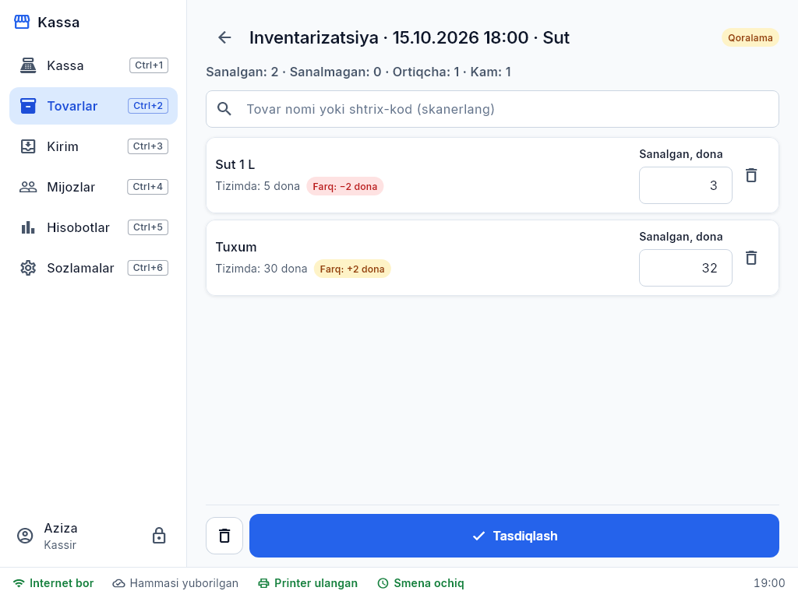

# 2. Tovarlar, kirim, inventarizatsiya

## Tovarlar ro'yxati (Ctrl+2)
Qidiruv (nom, shtrix-kod, PLU), kategoriya bo'yicha filtr; qoldig'i kam tovarlar belgilangan.

**Yangi tovar:** "Tovar qo'shish" yoki **noma'lum shtrix-kodni skanerlang** — karta shtrix-kod bilan ochiladi. Nom, birlik (dona/kg), kategoriya, sotish narxi, tannarx, eng kam qoldiq. Tarozi tovari uchun — "vaznli" va PLU.
Narx o'zgarishlari tarixi kartada saqlanadi.

## Excel'dan yuklash
**Import** → shablonni yuklab oling → to'ldiring → faylni tanlang → ustunlarni moslang → tekshiring. Xato qatorlar aniq ko'rsatiladi, to'g'rilari yuklanadi. Shtrix-kodi bor tovar — yangilanadi, yo'q — qo'shiladi.

## Kirim — tovar qabul qilish (Ctrl+3)
1. **Yangi kirim** → (ixtiyoriy) yetkazib beruvchi.
2. Tovarlarni **skanerlang** — har skan miqdorni +1 qiladi; miqdor, tannarx, yangi sotish narxini o'zgartirish mumkin.
3. Noma'lum shtrix-kod — o'sha yerning o'zida tovar yaratiladi.
4. **Tasdiqlash** — qoldiq oshadi (internetsiz ham). Tasdiqlanmagan kirim qoralama bo'lib saqlanadi.

## Inventarizatsiya (Tovarlar → Inventarizatsiya)
Hamma tovar yoki bitta kategoriya. Javondagi tovarlarni skanerlab sanang — dastur "tizimda" va "sanalgan" farqini ko'rsatadi. **Tasdiqlash**dan keyin qoldiq sanalganga tenglashadi.

## Kam qolganlar va buyurtma
Tovarlar → "Kam qolganlar" filtri. **Buyurtma ro'yxati** (CSV) — yetkazib beruvchiga yuborish uchun. Tovar kartasida — qoldiq harakatlari tarixi (kirim, savdo, qaytarish, inventarizatsiya).
