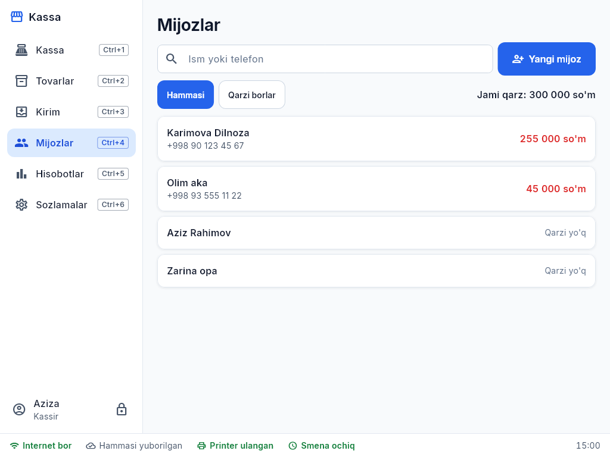
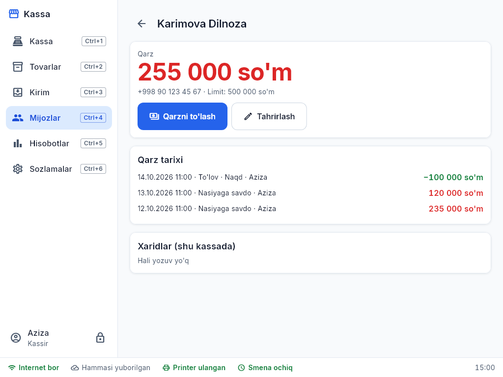

# 3. Mijozlar va nasiya daftari (Ctrl+4)

Qarzi borlar ro'yxat tepasida, jami qarz ko'rinib turadi. Qidiruv — ism yoki telefon.

## Nasiyaga sotish
Kassada to'lov turi **Nasiya** (yoki aralash) → mijozni tanlang. Mijozning **qarz limiti** bo'lsa va undan oshsa — menejer/ega PIN kerak.

## Qarzni to'lash
Mijoz kartasi → **To'lash** → summa (yoki **To'liq**) → naqd yoki karta → tasdiqlash. Qarzdan ko'p summa qabul qilinmaydi. Qolgan qarz darhol ko'rinadi.

Kartada: qarz tarixi (har savdo va to'lov, kim kiritgan), xaridlar. Limitni o'zgartirish — menejer/ega ruxsati bilan.
Qarz yozuvlari o'chirilmaydi — xato bo'lsa, teskari yozuv (to'lov yoki qaytarish) qilinadi.
