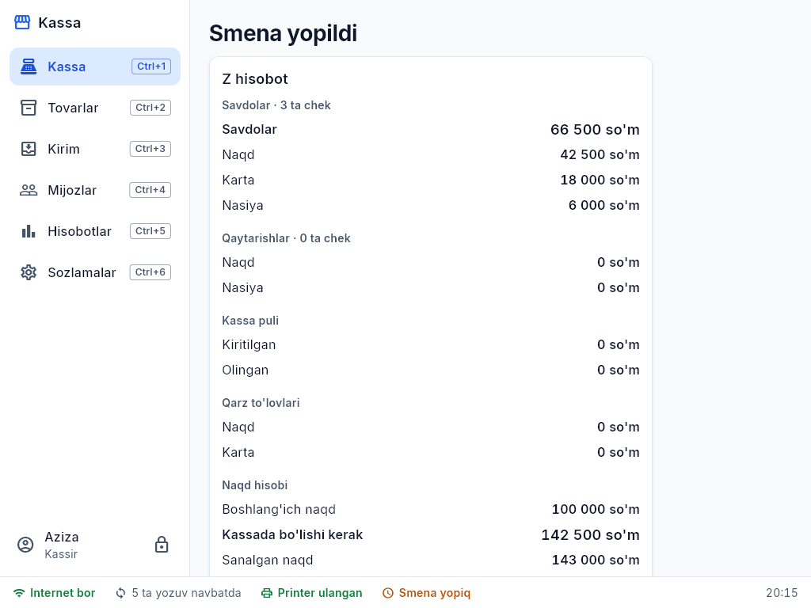
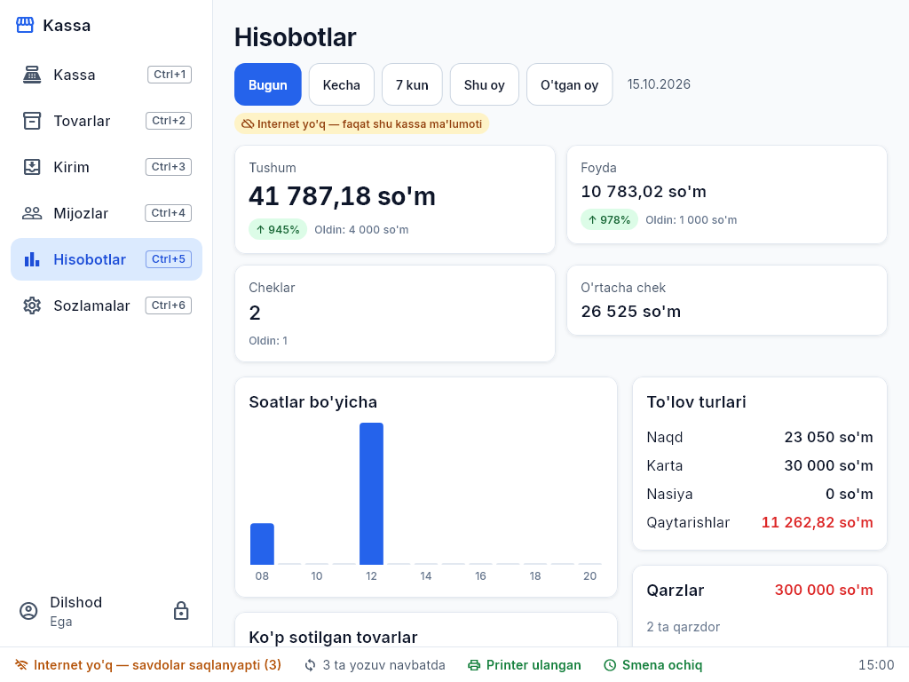

# 4. Smena, kassa puli va hisobotlar

## Smena
- **Ochish:** kassadagi boshlang'ich naqd.
- **X hisobot** — smena davomida joriy holat (savdo, to'lov turlari, qaytarishlar, kassadagi naqd).
- **Yopish:** naqd pulni sanab kiriting — "Kassada bo'lishi kerak" bilan farq (ortiqcha/kam) ko'rsatiladi, **Z hisobot** chop etiladi.

## Kassaga pul kiritish / olish (Ctrl+F9)
Maydalash uchun pul kiritish yoki inkassatsiya — summa va sabab bilan. Smena hisobotida ko'rinadi.

## Cheklar tarixi (Ctrl+7)
Har bir yopilgan chek: vaqt, kassir, mijoz, to'lov turi, summa, qaytarilganmi. Kun, to'lov turi yoki qidiruv (chek raqami, mijoz, tovar)
bo'yicha topiladi; chekni qayta chop etish (NUSXA) va qaytarish shu yerdan. Faqat shu kassaning cheklari ko'rinadi.

## Hisobotlar (Ctrl+5) — ega va menejer
Davr: **Bugun, Kecha, 7 kun, Shu oy, O'tgan oy**.
- **Tushum** (savdo − qaytarishlar), **foyda**, cheklar soni, o'rtacha chek — oldingi davrga nisbatan ↑/↓ %.
- Soatlar (bir kun) yoki kunlar bo'yicha grafik, to'lov turlari.
- Ko'p sotilgan tovarlar, kassirlar, qarzlar, ombor (qiymati, kam qolganlar, manfiy qoldiq).

Internet bo'lsa — barcha kassalar ma'lumoti (serverdan). Internet yo'q bo'lsa — sariq belgi "**faqat shu kassa ma'lumoti**".
Kassir hisobotlarni ko'rmaydi; kerak bo'lsa menejer PIN bilan ochiladi.
