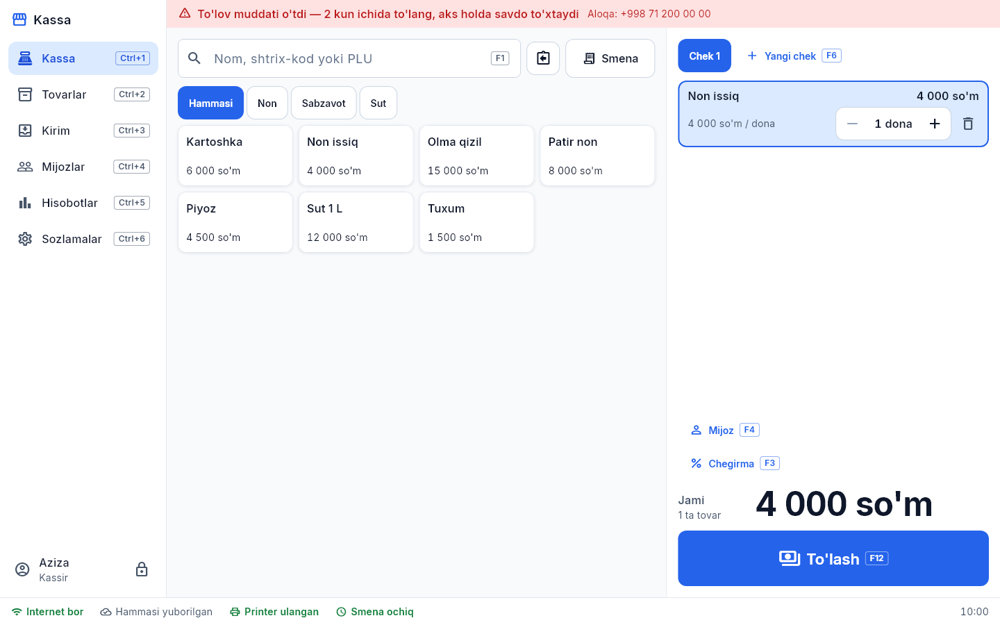

# 5. Obuna, yangilash va yordam

## Obuna
Dastur oylik obuna asosida ishlaydi. Holat har sinxronda yangilanadi, ekran tepasida ko'rinadi:

| Holat | Ekranda | Savdo |
|---|---|---|
| Sinov davri | ko'k: "Sinov davri: yana N kun" | ishlaydi |
| Tugashiga ≤ 3 kun | sariq: "Obunaga N kun qoldi — to'lovni unutmang" | ishlaydi |
| Muddat o'tdi (imtiyozli kunlar) | qizil: "N kun ichida to'lang, aks holda savdo to'xtaydi" | ishlaydi |
| Faqat ko'rish | kassada qizil: "Obuna muddati tugagan" | **to'xtaydi** (kirim ham); ko'rish, hisobot, sinxron ishlaydi |
| Bloklangan | "Do'kon bloklangan" | to'xtaydi |

To'lov qilingach, muddat avtomatik uzayadi — kassa keyingi sinxronda (bir daqiqa ichida) davom etadi. **Ma'lumot hech qachon o'chirilmaydi** — obuna tugasa ham.

## Internet
- Savdo, kirim, qarz — internetsiz ishlaydi, hammasi kassada saqlanadi.
- Pastki qatorda: internet holati, printer, smena, **navbatdagi yozuvlar soni**.
- Internetsiz **7 kundan** ortiq ishlansa savdo to'xtaydi ("Internetga ulaning") — ulanishi bilan davom etadi.

## Yangi versiya
Pastki qatorda "**Yangi versiya X**" chiqsa: Sozlamalar → **Ilova haqida** — yuklab olish havolasi. Yangi o'rnatuvchini ishga tushiring — eski versiya ustiga o'rnatiladi, ma'lumot saqlanadi. Yangilash majburiy emas.

## Yordam
To'lov, xodim qo'shish, parolni tiklash, yangi kassa ulash — administrator (dastur yetkazib beruvchi) bilan bog'laning. Aloqa raqami obuna ogohlantirishlarida va "Obuna muddati tugagan" xabarida ko'rsatiladi.
