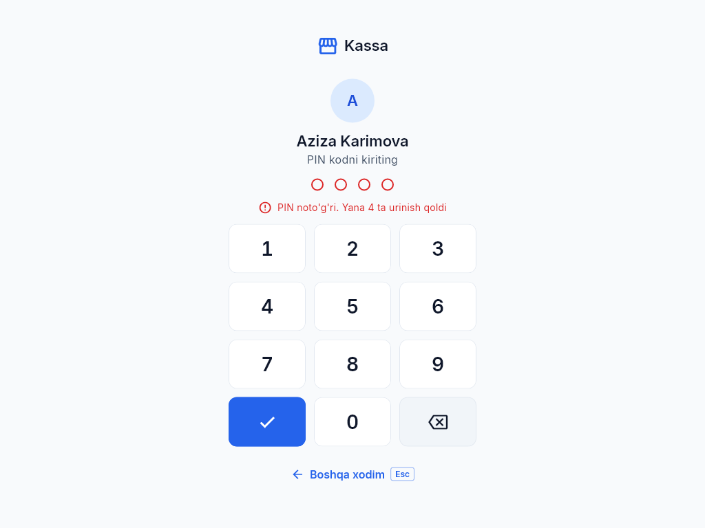
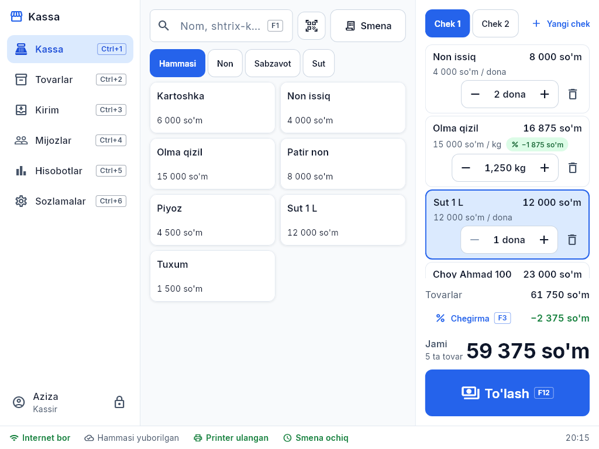
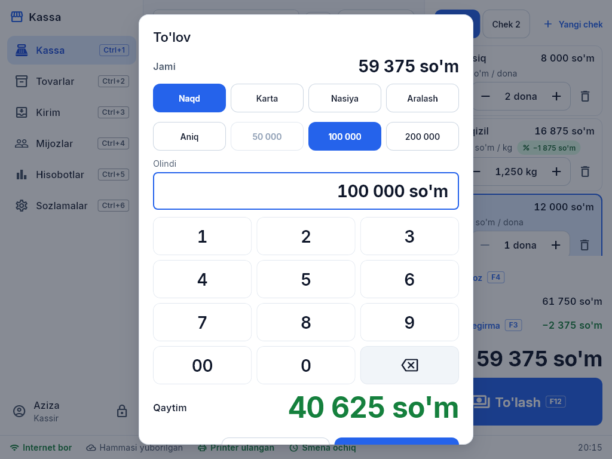

# Kassirga — bir sahifada

## 1. Kirish
Ismingizni bosing va **PIN kodingizni** kiriting (4–6 raqam). 5 marta xato kiritilsa — 1 daqiqa kutasiz.
Kassadan ketayotganda — chap pastdagi **qulf** tugmasi. Kassa bir necha daqiqa tegilmasa o'zi qulflanadi.

## 2. Smena
Ish boshida **Smena → Ochish**: kassadagi naqd pulni kiriting. Smena ochilmasa savdo qilib bo'lmaydi.
Ish oxirida **Smena → Yopish**: kassadagi pulni sanab kiriting — dastur farqni ko'rsatadi, Z hisobot chiqadi.

## 3. Savdo — 3 harakat
1. **Tovarni skanerlang** (shtrix-kod). Bir xil tovar yana skanerlansa — soni +1. Shtrix-kodsiz tovar (non, tuxum) — o'ngdagi **tez tugmalardan** yoki **F1** bilan nomini yozib.
2. **F12 — To'lash.**
3. To'lov turini tanlang va **Enter**:
   - **Naqd** — mijoz bergan pulni kiriting yoki tez tugma (Aniq, 50 000, 100 000, 200 000). Qaytim katta harf bilan ko'rinadi.
   - **Karta** — terminalda to'lovni o'tkazing, keyin tasdiqlang.
   - **Nasiya** — mijozni tanlang (yoki yangi mijoz). Qarz limitidan oshsa — menejer ruxsati kerak.
   - **Aralash** — bir qismi karta/nasiya, qolgani naqd.

Chek printeri ulangan bo'lsa chek o'zi chiqadi. Printer ishlamasa ham savdo to'xtamaydi.

## 4. Savatda
- **Miqdor** — qatorni bosib yoki **F2** (tarozi tovari: 0,250 kg).
- **O'chirish** — qatordagi savat belgisi yoki **Delete** (adashsangiz — pastda chiqadigan "**Bekor qilish**" tugmasi qaytaradi).
- **Chegirma** — **F3**. 5% gacha o'zingiz; kattasi — menejer PIN.
- **Mijoz** — **F4** (nasiya yoki chekda ism uchun).
- **Kechiktirilgan chek** — mijoz biror narsa olib kelguncha: **F6** yangi chek ochadi, eskisi tepada turadi.

## 5. Qaytarish (F8)
Chek raqamini kiriting yoki chekdagi kodni skanerlang → qaytariladigan tovarlarni belgilang → sabab → **menejer PIN** → pul naqd qaytariladi yoki qarzdan ayiriladi.

## 6. Internet yo'q bo'lsa
Hech narsa qilmang — savdo davom etadi. Pastki qatorda "**N ta yozuv navbatda**" ko'rinadi; internet qaytganda o'zi yuboriladi. 7 kundan ko'p internet bo'lmasa savdo to'xtaydi — egaga ayting.

## 7. Qizil yozuv chiqsa
- "**Obuna muddati tugagan**" yoki "**Do'kon bloklangan**" — savdo to'xtaydi, egaga ayting.
- "**Bu tovarni sotib bo'lmaydi**" — tovar o'chirilgan yoki narxi yo'q: egaga yoki menejerga ayting.
